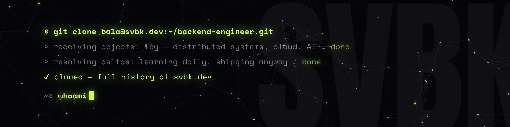

### `$ whoami`

**S. V. Bala Kumaran** — backend engineer. 15 years of distributed systems, cloud orchestration & APIs.
Now vibe-coding at the edge of what backends were never meant to do. Learning daily. Shipping anyway.

`→` full history at **[svbk.dev](https://svbk.dev)** · connect on **[LinkedIn](https://www.linkedin.com/in/balakumaransv/)**
